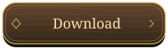
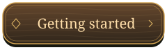
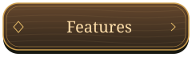
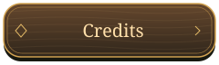
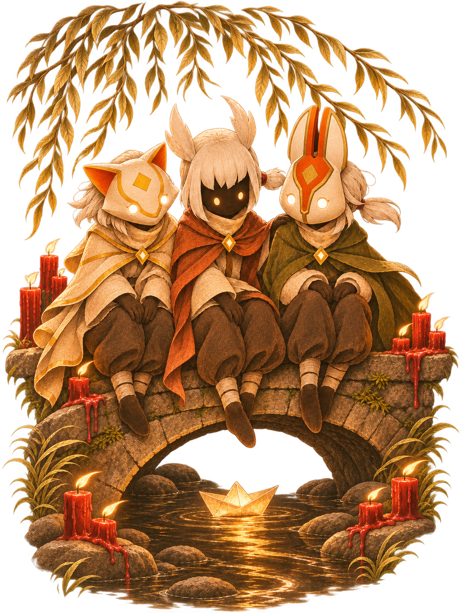

  

<table>
<tr>
<td width="45%" align="center">

</td>
<td width="55%">
<h2>Welcome to our little clearing</h2>

I put this launcher together to make joining our world feel a little more special. A quiet night, a few candles, and a place for us to play together.

White hair in the wind, a boat on the stream, and the forest keeping us company. These are the little details I wanted to bring with us, even before the game begins.

I hope you feel at home here.

<em>— Bea</em>

 

<b>Windows · Local accounts · LAN &amp; Tailscale</b>

</td>
</tr>
</table>

## Little details

| Under the willow | Ready for an adventure |
| :--- | :--- |
| **A living illustration** — wind in the leaves, flickering candles, and water around a little paper boat. | **One-step preparation** — create a separate game copy with the required patch. |
| **A forest at night** — wind, chimes, crickets, an occasional owl, and a quiet stream. | **Your own characters** — pick a username, keep multiple accounts, and choose who to play before entering. |
| **Warm little touches** — wooden button sounds, soft motion, and golden details. | **Near or far** — connect over LAN or Tailscale using your server address. |

## Your first visit

1. **Download** `Sky-Cozy-Launcher.exe` from the [releases page](https://github.com/beacafe/sky-cozy-launcher/releases).
2. **Prepare** your game using the launcher's preparation button. Steam and Sky: Children of the Light need to be installed first.
3. **Connect** by entering the server address.
4. **Choose your character** or create an account with a username, then enter the game.

The little gear opens settings for button sounds and forest ambience. You can switch between saved accounts before playing.

<b>Which download should I pick?</b>

- **Sky-Cozy-Launcher.exe** — the launcher itself.
- **Sky-Cozy-Third-Party.zip** — credits, licenses, and SSL Patch source code.
- **SHA256SUMS.txt** — checksums for verifying the downloads.

## Credits & thank-yous

An independent fan project, not affiliated with thatgamecompany. Third-party credits,
licenses, and SSL Patch source code are included with each release.

Still growing, still experimental. Thank you for being part of this little world.

<i>Made cozy by Bea. See you beneath the willow.</i>

