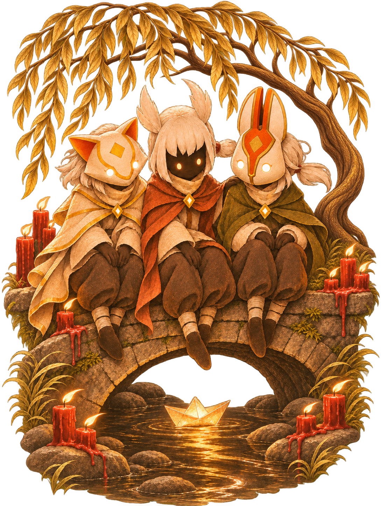

  

<h3>A little Sky to share with friends</h3>

Hi, I'm Bea! Sky Cozy is my little private server for Sky: Children of the Light, built with care on XYSky.

<b>Currently in development · Invite-only access</b>

A place for friends to explore, make memories, and enjoy the journey together. Access is by invitation while I keep tending to our little world.

Here you can find the launcher we use to join Sky Cozy. If you already have an invitation, your next adventure starts below.

<em>— Bea</em>

## About the server

Sky Cozy is my ongoing private-server project, built on XYSky. I'm working on the
server's account system, character progression, events, and tools for running it.

Sky Cozy is **invite-only**. The launcher is here for invited friends to join our server.

## Already invited?

Welcome in! Use the steps below to join **Sky Cozy**.

## Your first visit

1. **Download** `Sky-Cozy-Launcher.exe` from the [releases page](https://github.com/beacafe/sky-cozy-launcher/releases).
2. **Prepare** your game using the launcher's preparation button. Steam and Sky: Children of the Light need to be installed first.
3. **Connect** by entering the server address.
4. **Choose your character** or create an account with a username, then enter the game.

The launcher opens in English by default. Choose **Settings → Language → Português** to switch to Portuguese; your preference is remembered.

You can switch between saved accounts before playing.

<b>Which download should I pick?</b>

- **Sky-Cozy-Launcher.exe** — the launcher itself.
- **Sky-Cozy-Third-Party.zip** — credits, licenses, and SSL Patch source code.
- **SHA256SUMS.txt** — checksums for verifying the downloads.

## Credits & thank-yous

An independent fan project, not affiliated with thatgamecompany. Third-party credits,
licenses, and SSL Patch source code are included with each release.

Sky Cozy is still in development. Thank you for following the project.

<i>Sky Cozy · A private Sky server by Bea.</i>

